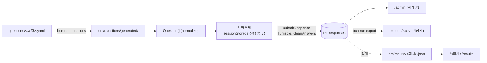

# 데이터 모델

회차, 문항, 응답, 집계가 어떻게 이어지는지와 바꿀 때 지킬 것을 적는다. 각각의 원본은 코드다.

| 무엇 | 원본 | 형식 |
|---|---|---|
| 회차 | `src/editions.ts` | `Edition` |
| 문항 | `questions/<회차>.yaml` | 머리말 주석, `src/questions/survey.ts` 의 `RawQuestion` |
| 응답 | D1 `responses` (`src/db/schema.ts`) | 아래 "answers" |
| 집계 | `src/results/<회차>.json` | `src/results/aggregate.ts` 의 `ResultSet` |

## 키

세 가지 문자열이 모든 것을 잇는다. 응답이 쌓인 뒤에는 바꾸지 않는다.

- **회차 id** (`2026`, `2027-frontend`) — 주소, 문항 파일 이름, `responses.edition`, 집계 파일 이름이 모두 이 값이다. 하나를 바꾸면 나머지와 끊어진다.
- **문항 id** — `answers` 의 키이자 회차 간 비교의 키다. 같은 id 는 모든 회차에서 같은 뜻, 같은 유형이어야 한다.
- **선택지 code** — `answers` 의 값이다. 뜻을 바꾸려면 새 code 를 쓰고, 기존 code 는 지우지 않는다(선택지를 늘릴 때는 "기타"를 쪼갠다).

테스트(`src/editions.test.ts`)가 막는 것은 같은 문항 id 의 유형·`order` 일치와 한 문항 안의 code 중복뿐이다. 회차끼리 같은 code 를 쓰는지, code 의 뜻이 그대로인지는 리뷰에서 본다.

## responses

응답 1건이 1행이다.

| 칸 | 뜻 |
|---|---|
| `id` | 서버가 만드는 UUID. 응답자와 이어지는 값이 아니다 |
| `edition` | 회차 id |
| `answers` | JSON. 문항 id → 답 |
| `created_at` | UTC ISO 문자열. 한국 날짜로 묶을 때는 `date(created_at, '+9 hours')` |

**일부러 없는 칸:** 응답자 식별자, 연락처, IP, User-Agent, 유입 경로. 경품을 주지 않으므로 연락처를 받을 이유가 없다. 칸을 두지 않는 것으로 익명성을 지킨다([개인정보 조사](research/2026-10-privacy-law.md)). 개발자 유형은 브라우저에서만 계산하고 저장하지 않는다. 답에서 다시 계산할 수 있어 얻는 것이 없고, 공유 링크와 응답을 잇는 단서만 생긴다.

**답을 행으로 나누지 않는 이유:** 답을 문항당 1행(long format)으로 나누지 않고 JSON 한 칸에 둔다. 응답 1건이 수십 행이 되면 D1 무료 플랜의 쓰기 한도(하루 10만 행)에 금방 닿고, 회차마다 문항이 달라도 마이그레이션이 필요 없다. 집계는 SQL 이 아니라 TypeScript(`aggregate.ts`)로 하므로 칸 단위 조회가 필요 없다.

## answers

서버가 저장하기 전에 `cleanAnswers`(`src/questions/logic.ts`)가 화면과 같은 규칙으로 다시 검사하고 정리한다.

| 문항 유형 | 값 |
|---|---|
| `single` | 선택지 code 문자열 |
| `multi` | code 배열. 중복 없고 `limit` 이하 |
| `scale` | 정수를 담은 **문자열** (`"1"`~`"5"`). 척도는 모두 5점이다(`SCALE_POINTS`, 테스트가 YAML 의 `min`·`max` 를 묶는다) |
| `long` | 앞뒤 공백을 지운 문자열, 2000자 이하 |
| `<문항 id>_other` | "기타"를 고르고 직접 적었을 때만. 100자 이하. 집계와 결과 화면에는 쓰지 않고 CSV 에만 나온다 |

- `show_if` 로 보이지 않은 문항의 답은 서버가 버린다.
- 건너뛴 선택 문항은 키 자체가 없다. 그래서 키가 없으면 "안 보였다"와 "건너뛰었다"를 구분할 수 없다. 둘을 나누려면 그 응답으로 `visibleQuestions` 를 다시 계산한다(`aggregate` 의 `shown`).

## 브라우저에만 두는 것

서버로 보내지 않는다. 처리방침에 공개했으므로 바꾸면 처리방침도 고친다.

- **진행 중인 답** — 그 탭의 `sessionStorage`(`src/questions/progress.ts`). 제출하지 않은 답을 서버에 두지 않고, 공용 PC에 남기지 않으려는 것이다(#9). 되살릴 때 지금 문항에 맞지 않는 답은 버린다.
- **응답 완료 표시** — `localStorage` 의 `survey-<회차>-done`(값은 유형 slug). 같은 브라우저에서 다시 응답하지 않게 한다. 서버에는 중복을 막는 수단이 없다. 브라우저를 바꾸면 다시 낼 수 있다는 것을 알고 받아들였다.

## 집계

- 결과 화면은 `src/results/<회차>.json` 만 읽는다. 원본 응답은 공개 페이지로 넘어가지 않는다.
- 답한 사람이 `MIN_GROUP`(30)명보다 적은 문항과 집단별 칸은 숨긴다. 집단은 `BREAKDOWNS` 에 정하고, 한 번에 한 기준으로만 나눈다.
- `src/results/index.ts` 에 회차를 등록해야 화면에 나온다.
- 지금 집계 파일을 만드는 스크립트는 예시 회차용 `scripts/sample-results.ts` 뿐이다.

## 바꿀 때

- **스키마:** `src/db/schema.ts` 를 고치고 `bunx drizzle-kit generate --name <desc>`. 미리보기와 운영 모두 배포 직전에 마이그레이션을 적용하므로 이전 코드가 그대로 돌아가는 변경이어야 한다. 칸이나 테이블을 지울 때는 먼저 그것을 쓰지 않게 바꾸는 PR 을 병합해 배포하고, 삭제 마이그레이션은 다음 PR 로 올린다. 한 PR 에 넣으면 운영에서는 배포 직전에, 미리보기에서는 함께 쓰는 `survey-preview` 를 읽는 다른 PR 의 미리보기에서 이전 코드가 깨진다.
- **문항:** `fixed: true` 문항은 문구·선택지·순서를 바꾸지 않는다. 형식 규칙은 YAML 머리말에 있다.
- **보관 기한:** 회차의 `deleteAt` 은 동의 화면과 처리방침에 공개한 원본 삭제일이다. 자동으로 지우지 않는다([운영](operations.md)).
